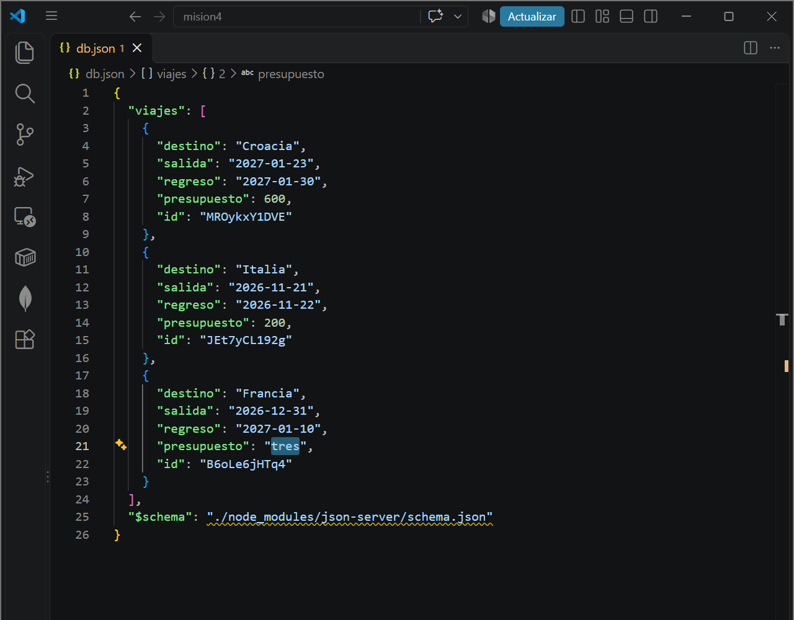
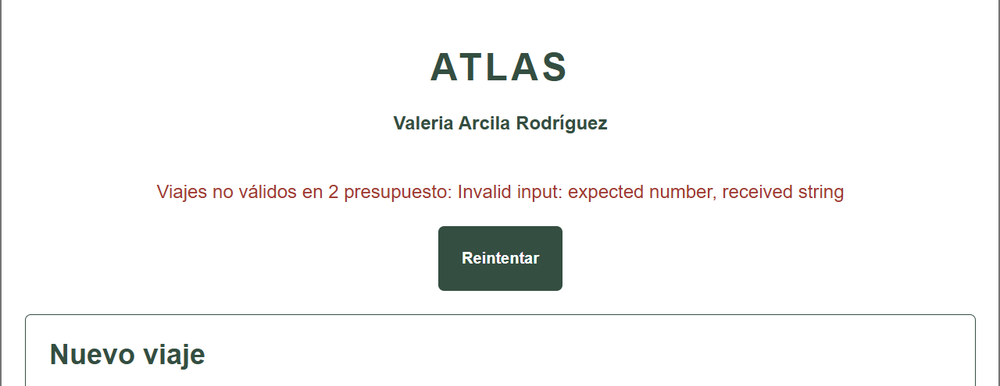

# Misión 4

Programación web I, cliente.

Atlas es una aplicación que permite guardar y organizar información sobre los viajes planificados, incluyendo el destino, las fechas de salida y regreso y el presupuesto. Calcula la cantidad de viajes y la suma de sus presupuestos.

## Cómo probarlo

Se debe ejecutar `npm install` y arrancar dos terminales:

1. **vite**. Ejecutar `npm run dev` para iniciar la aplicación.

2. **json server**. Ejecutar `npx json-server db.json` para iniciar la api, que utiliza por defecto el puerto 3000.

La dirección de la api se configura como `VITE_API_URL = http://localhost:3000`, indicada en `.env.example`.

La aplicación se divide en tres partes:

1. **Estadísticas**. Muestra la cantidad de viajes y la suma de sus presupuestos.

2. **Viajes**. Muestra los viajes guardados, incluyendo el destino, las fechas de salida y regreso y el presupuesto. Cada viaje tiene un botón "Eliminar" para borrarlo.

    Si ocurre un error al cargar los viajes, aparece un mensaje y un botón "Reintentar".

3. **Formulario**. Permite añadir nuevos viajes. Los fields tienen las siguientes validaciones.

    - **Destino**. Debe contener al menos tres caracteres.

    - **Salida**. Debe ser una fecha válida, igual o posterior a hoy.

    - **Regreso**. Debe ser una fecha válida, igual o posterior a la salida.

    - **Presupuesto**. Debe ser un número mayor que cero y menor o igual a mil.

    Si algún field no cumple las condiciones, aparece un mensaje de error debajo del mismo.

## `safeParse()`

Además de validar los datos del formulario con zod, se utiliza `safeParse()` para comprobar que las respuestas de la api cumplen los esquemas definidos, tanto en GET (obtener los viajes) como en POST (enviar un viaje).

Para asegurar su funcionamiento, se modificó temporalmente un viaje de db.json, cambiando el presupuesto de número a string.

1. Dato corrupto.

    

2. Error detectado.

    

Al recargar la aplicación, `safeParse()` detectó que el presupuesto no era un número y mostró un mensaje de error indicando el field incorrecto: índice = 2, field = presupuesto.

## Uso de IA

Utilicé claude para resolver dudas durante el desarrollo.

**Prompt 1. Hay alguna función de rhf que permita dirigir el cursor a un field concreto después de enviar un formulario?**

La respuesta fue usar `setFocus()` con `setTimeout(..., 0)` dentro de `onSubmit()`, después de `reset()`. Entendí su funcionamiento y me pareció una buena solución, porque al ejecutar `setFocus()` inmediatamente después de `reset()` no funcionaba. Con `setTimeout()` se retrasa la ejecución y da tiempo a rhf para restablecer las referencias de los fields.

**Prompt 2. Cómo se pueden validar las fechas?**

Aunque el formulario ya utiliza `type = "date"`, webi recomendó validar también las fechas con zod. Implementé la función `validarFecha()` que comprueba que la fecha tenga el formato `aaaa-mm-dd` y que sea una fecha real, evitando aceptar fechas inexistentes como el 30 de febrero.

## Autopsia

**Decisión 1. Uso `preprocess()`.**

Decidí utilizar `preprocess()` para evitar que zod interpretara un presupuesto vacío como cero y mostrara el error "Presupuesto debe ser mayor que cero". 

Esto tiene un inconveniente, ya que las validaciones que comparan las fechas pueden no ejecutarse hasta que el presupuesto sea válido. Preferí mantenerlo porque me parecía más importante mostrar el error adecuado que evitar el retraso de esas validaciones.

**Decisión 2. Hook `useTemporizador()` en lugar de `onChange`**

Inicialmente utilizaba `onChange` para eliminar el mensaje de éxito cuando se modificaba algún field del formulario, webi indicó que no era la mejor solución.

Decidí crear el hook `useTemporizador()` para que el mensaje "Enviado correctamente" permaneciera visible durante cinco segundos y después desapareciera automáticamente, ya que no tenía sentido dejarlo en pantalla indefinidamente. Además este hook podría reutilizarse en un posible mensaje "Eliminado correctamente".
